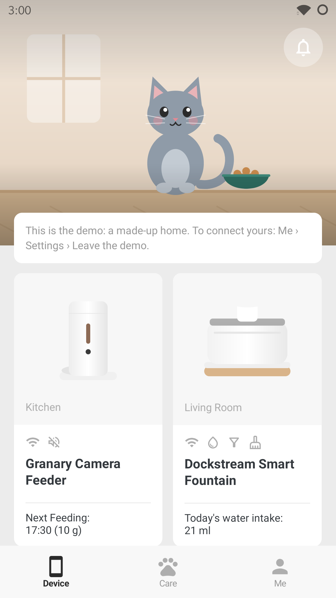
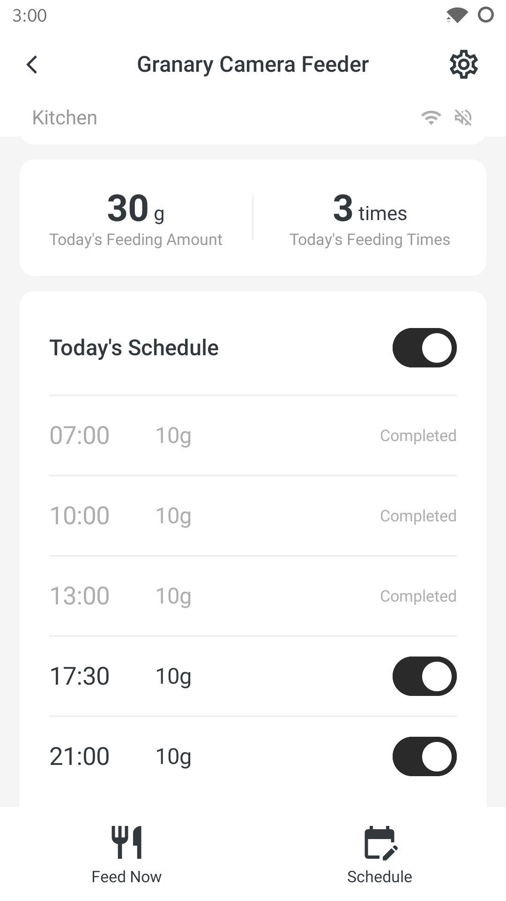
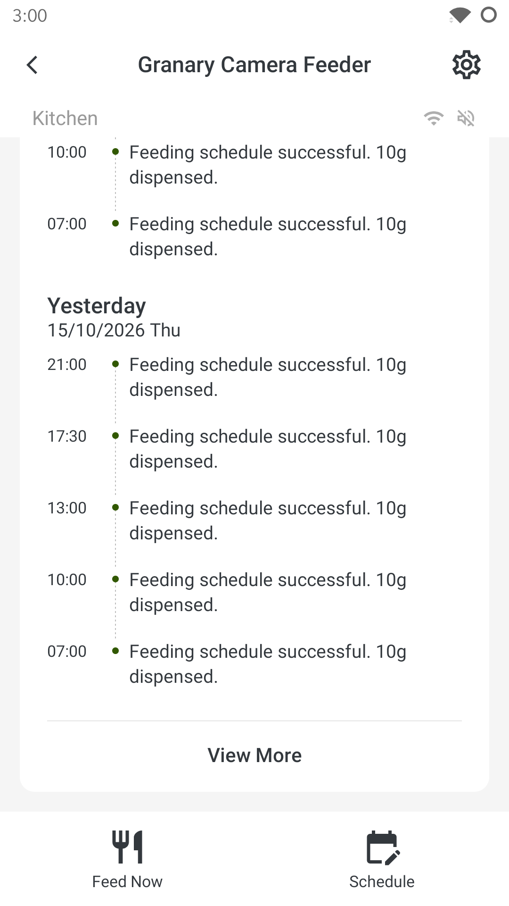
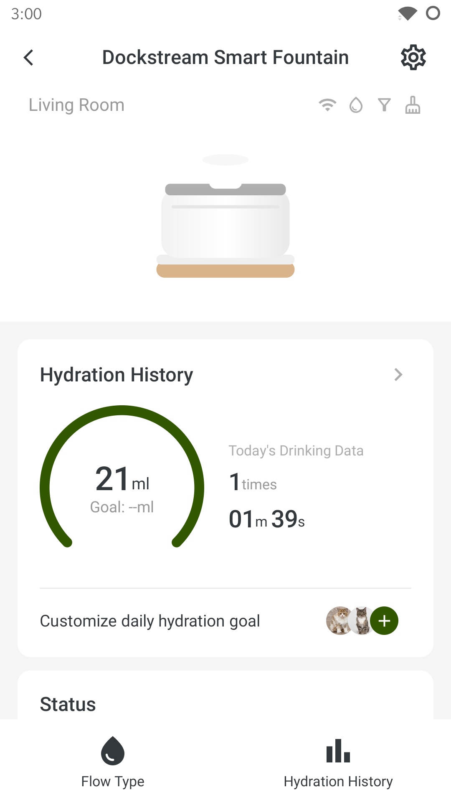
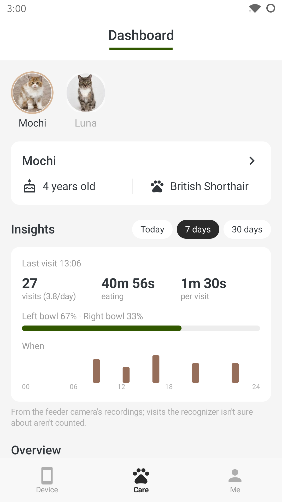

# LiberPet

An open-source app for PETLIBRO feeders and water fountains, through **your own Home Assistant**. Its screens follow
the official Petlibro app's layout, so it feels familiar.

<p>
  
  
  
  
  
</p>

The screenshots are the built-in demo: a made-up home, with invented pets.

## Download

- **Android:** [the latest `liberpet.apk`](https://github.com/gccammelli/liberpet/releases/latest/download/liberpet.apk)
  from GitHub Releases.
- **iPhone (beta):** see [below](#iphone-beta).

Not ready to connect anything? Open the app and tap **Try the demo**.

## What you need

- **Home Assistant**, with the community [PETLIBRO integration](https://github.com/jjjonesjr33/petlibro) (from HACS)
  signed in to a Petlibro account.
- **A PETLIBRO feeder or fountain.** Tested with the Granary Smart Camera Feeder (PLAF203) and Dockstream Smart
  Fountains (PLWF105); other models the integration supports should mostly work.
- **For the optional extras:** a computer at home that's always on (see [Optional extras](#optional-extras)).

## How it works

LiberPet talks only to **your Home Assistant**. Home Assistant does the rest:

```
LiberPet ──▶ your Home Assistant ──▶ Petlibro's cloud ──▶ feeder / fountains   (status, logs, controls)
                       │
                       └──▶ go2rtc on your network ──▶ feeder camera            (live view, local only)
```

- **Device data and controls need Petlibro's cloud.** Home Assistant reaches it through the PETLIBRO integration.
  The devices stay connected to Petlibro's cloud, and every status update, log and command goes through it. If the
  cloud or your internet is down, Home Assistant can't read or control the devices. Scheduled meals still dispense,
  because the schedule is stored on the feeder.
- **The camera is local.** Its video goes straight from the feeder to go2rtc on your network, then to Home
  Assistant, and never through Petlibro's servers. Setup: [docs/camera.md](docs/camera.md).
- **Pet photos** come through Home Assistant too, from the integration's image entities.

Petlibro allows one login per account. Give Home Assistant a second Petlibro account and share your devices
with it, so the official app can stay signed in on your main account.

## Setup

1. **In Home Assistant:** install the PETLIBRO integration, and give each device an area (its room in LiberPet).
2. **In LiberPet:** enter your Home Assistant address and a long-lived access token (your Home Assistant
   profile › Security › Long-lived access tokens). Away from home, use an address that works from outside, such as
   your Home Assistant Cloud address or your own HTTPS domain.
3. **Optional:** the live camera ([docs/camera.md](docs/camera.md)) and the [extras](#optional-extras).

## What works

- **Home:** every feeder and fountain, with problems flagged (filter or cleaning overdue, low water, offline).
- **Feeder:** live camera (muted by default, with full screen) and snapshots; Feed Now; today's amount, feeding count
  and schedule, with today-only skips; the schedule, with adding, editing, deleting and switching plans on or off;
  desiccant status and reset; indicator light; feeding logs; firmware version.
- **Fountain:** today's intake, drinking count and time; water level, filter and cleaning status, with resets and
  cycles; flow type; daily hydration goal and calibration; indicator light; drinking logs; water intake history by
  day, week, month and year.
- **Tips:** long-press a device card on Home to rearrange; long-press the Home picture to use your own photo (it stays
  on the phone); Me › Appearance for System, Light or Dark.

## Optional extras

Off until you switch them on in **Me › Settings**. Each says what it needs.

| Extra | What it does | Needs |
|---|---|---|
| **Care tab** | Each pet's profile, weight and water; Cat Insights if that's on | nothing more |
| **Recordings** | Play the feeder camera's recorded clips, and record a clip on demand | the camera, plus LiberPet's [recorder](tools/recorder/README.md) on a home server |
| **Cat Recognition** (beta) | Teach LiberPet your cats from short clips, so recordings say who ate at each bowl | Recordings, plus LiberPet's [recognizer](tools/recognizer/README.md) |
| **Cat Insights** (beta) | Each cat's visits, time eating and favourite bowl, in the Care tab | Cat Recognition |

The recorder and recognizer are small Python programs for a Linux computer that's always on; they also only talk to
Home Assistant.

## What doesn't

- **Meal Call, two-way audio, Petlibro's video cloud and SD-card playback:** no open implementation exists yet. Use
  the official app for these.
- **Exact logs** need the integration's **Recent Activity** sensor, a small addition proposed upstream. Without it,
  LiberPet builds logs from Home Assistant's history, so times can lag by up to a few minutes.
- **Per-pet food and water:** Care shows the totals of each pet's linked devices, unless Cat Insights is on.
  Petlibro only splits them per pet with RFID models.

## Other PETLIBRO devices

LiberPet shows feeders (models starting PLAF) and water fountains (PLWF); other PETLIBRO devices are skipped for now.
A model in those families mostly works, minus anything its entities name differently.

Have a device that's missing or half-working? [Open a device request](https://github.com/gccammelli/liberpet/issues/new?template=new-device.yml)
with its model and the entities Home Assistant shows for it. That's usually enough to add it. Pull requests are welcome
too: device screens live in `shared/src/commonMain/kotlin/io/github/gccammelli/liberpet/ui/`.

## Support the project

LiberPet is free and always will be. Donations pay for test devices, so more PETLIBRO models can be supported:
[Buy me a coffee](https://buymeacoffee.com/cammelli) (also in the app, under **Me**).

Bugs and questions: [GitHub issues](https://github.com/gccammelli/liberpet/issues), or **Me › Help, bugs and new
devices** in the app.

## Privacy

LiberPet talks only to the Home Assistant address you enter. No analytics, no ads, no other servers. Details:
[PRIVACY.md](PRIVACY.md).

## iPhone (beta)

LiberPet builds for iPhone too, from the same code. Each release has an unsigned `liberpet.ipa`; install it with
[SideStore](https://sidestore.io) (or AltStore), which signs it with your own free Apple ID. It's checked in the iOS
simulator; it hasn't been tried on a real iPhone yet. Live view and clips play with iOS's own video player.

## Building

```
./gradlew :app:assembleDebug          # a debug build
./gradlew :app:assembleRelease        # the release build (unsigned unless LIBERPET_KEYSTORE is set)
```

Release builds are reproducible: an unsigned build from the same tag matches the signed release apart from the
signature. Pushing a `v*` tag builds and publishes the signed APK (and the `.ipa`); it needs the repository secrets
`KEYSTORE_BASE64`, `KEYSTORE_PASSWORD`, `KEY_ALIAS` and `KEY_PASSWORD`.

**Adding or removing an optional extra:** each one is an entry in
[`Features.kt`](shared/src/commonMain/kotlin/io/github/gccammelli/liberpet/Features.kt); its screens check
`Feature.X.on()`, and Settings lists it by itself.

## Disclaimer

LiberPet is an unofficial app, not affiliated with or endorsed by PETLIBRO. PETLIBRO, Granary and Dockstream are
trademarks of their owner. It uses none of Petlibro's code or assets: the device pictures are simple drawings, and the
demo pets' photos are AI-generated. Provided as is, without warranty.

[](https://buymeacoffee.com/cammelli)
